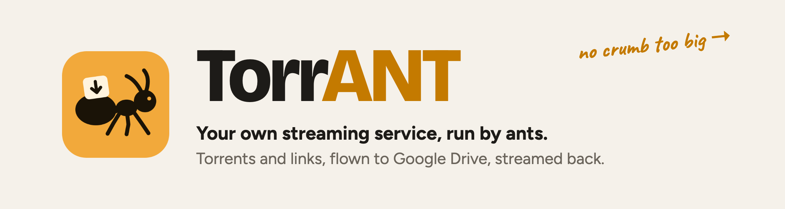
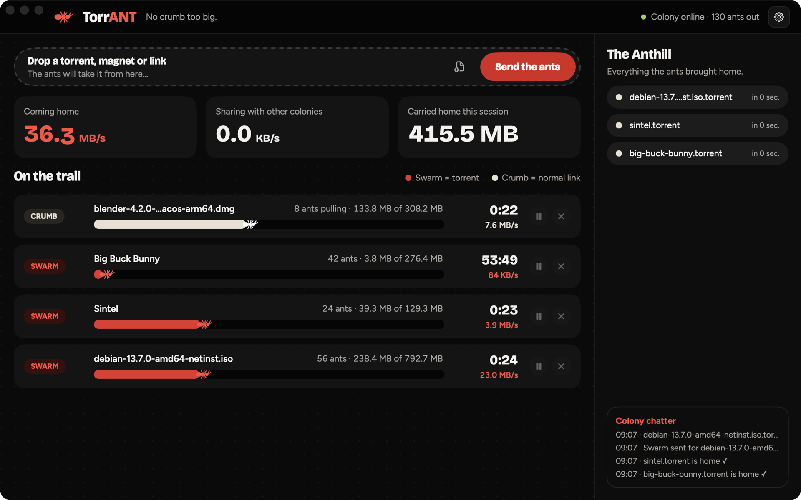
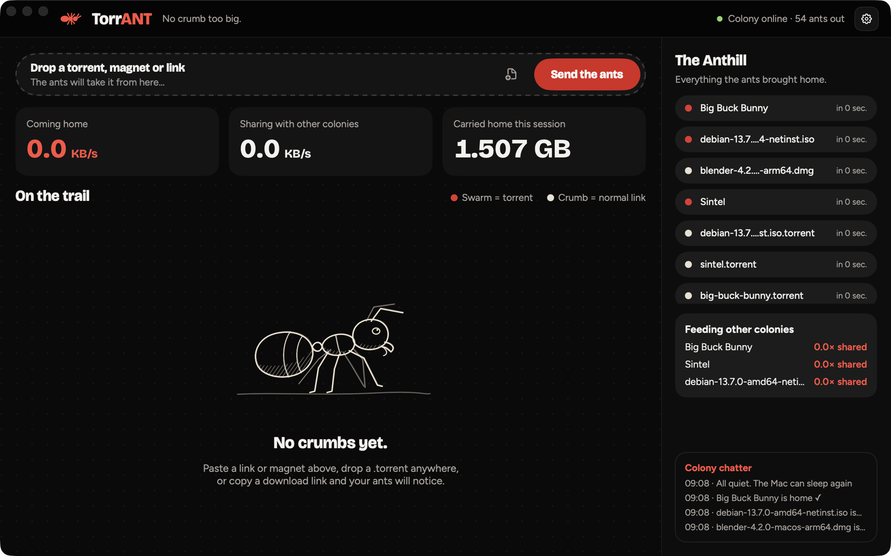
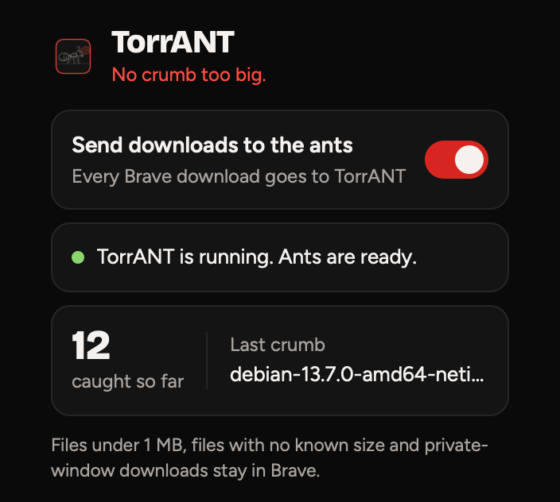

<div align="center">

<picture>
  <source media="(prefers-color-scheme: dark)" srcset="docs/assets/banner-dark.png">
  
</picture>

### Your own streaming service, run by ants. TorrANT downloads torrents and links, flies them up to Google Drive so your Mac stays empty, and streams them back like YouTube, with posters, resume, a night shift and a Telegram bot in your pocket. No crumb too big.


[**What it does**](#what-it-does) ·
[**Brave hand-off**](#catching-every-brave-download) ·
[**Google Drive**](#sending-things-to-google-drive) ·
[**Library & streaming**](#library-and-streaming) ·
[**Night shift**](#link-grabber-and-night-shift) ·
[**Design notes**](docs/adr/README.md) ·
[**Security**](SECURITY.md)

</div>

<br>

<p align="center">
  
</p>
<p align="center"><sub>The Colony, 8 Nov 2026. One crumb (a direct link to Blender, 8 ants pulling) and three swarms (Debian, Sintel, Big Buck Bunny) coming home at 36.3 MB/s together. Every number on this screen moves every frame and never goes backwards.</sub></p>

---

## At a glance

<table>
<tr>
<td align="center"><h3>2</h3>kinds of food<br><sub>swarms (torrents) and<br>crumbs (plain links)</sub></td>
<td align="center"><h3>8</h3>ants per crumb<br><sub>parallel connections<br>on one link</sub></td>
<td align="center"><h3>36.3 MB/s</h3>measured<br><sub>four downloads at once,<br>1.5 GB home in about a minute</sub></td>
<td align="center"><h3>Every frame</h3>live numbers<br><sub>speeds, sizes and bars<br>that never run backwards</sub></td>
<td align="center"><h3>1 click</h3>from Brave<br><sub>every download over 1 MB<br>goes to the ants</sub></td>
<td align="center"><h3>1 click</h3>to Google Drive<br><sub>seasons unpacked first,<br>so episodes stream</sub></td>
<td align="center"><h3>0</h3>accounts, servers<br>or tracking</td>
</tr>
</table>

**The story.** It started as a downloader and became a colony. Ants carry everything home, winged
ants fly it up to Google Drive so the Mac never fills up, and when you want to watch something the
colony streams it straight back, from wherever it lives. You can even send the ants out from your
phone at midnight and wake up to a full Library.

Ants live for the swarm. A torrent is a swarm: thousands of colonies sharing pieces of the
same thing, and TorrANT's ants join in, bring the pieces home and share some back. But an ant never walks
past food lying on the ground, so a plain download link is a crumb, grabbed on sight and dragged home by
eight ants at once. Everything that arrives goes into the Anthill. And when the Anthill gets full, winged ants
fly the finds up to Google Drive, where they play straight from the cloud.

The theme is there to make it fun; the screens are there to be read at a glance. Red means a swarm,
bone means a crumb, and every label says what it means in plain words.

---

## What it does

| | |
|---|---|
| **Joins swarms** | Torrents and magnet links, with DHT, peer exchange and local peer discovery, so the ants find each other without a tracker. Up to 80 peers per swarm. |
| **Grabs crumbs** | Plain HTTP, HTTPS and FTP links, split across 8 connections so one file comes home in parallel pieces. Up to 8 downloads run at once. |
| **Catches every Brave download** | A small Brave extension hands each download to TorrANT with your login for that site, so files behind a sign-in still work. [How it works ↓](#catching-every-brave-download) |
| **Lets you pick what to carry** | Opening a `.torrent` shows its files first: tick only the ones you want, choose the folder, start now or later. |
| **Spots crumbs on the clipboard** | Copy a download link or a magnet anywhere and a *Crumb spotted!* banner offers to grab it. |
| **Sends things to Google Drive** | A cloud button on every finished download moves it into Google Drive, after asking and saying how much data the upload will use. A Google Drive page shows each upload live. [How it works ↓](#sending-things-to-google-drive) |
| **Unpacks zipped seasons** | A season that arrives as one `.zip` can't stream from Drive, so TorrANT unpacks it into a folder of episodes first, checks every byte came out, and bins the zip. Also on its own from the Anthill's right-click menu. |
| **Streams from Drive like YouTube** | ▶ plays straight from Google Drive in VLC without downloading the file: starts in about 2 s, skips in about 3 s, picks up where you stopped. [How ↓](#library-and-streaming) |
| **Has a Library** | Posters and clean titles for everything in Drive, seasons with their episodes, and a *Continue watching* row. |
| **Grabs links in bulk** | Paste a web page and the ants list every video, archive, torrent and magnet on it, with sizes. Download now or leave them for the night shift. [How ↓](#link-grabber-and-night-shift) |
| **Works the night shift** | Queued downloads run from 1 to 7 AM (your times), pause what's unfinished at the end and carry on the next night. Never starts on a hotspot or a Low Data Mode network. |
| **Has a pocket remote** | Your own private Telegram bot. Share a link and it joins tonight's night shift, with ▶️ *Start now* and ❌ *Remove* buttons right under it. 📊 *Status* opens a live view that updates itself with progress bars, speed and time left. 🌙 *Queue* lists tonight's batch. ⏸ / ▶️ pause or wake every ant. When a movie reaches the Library, its poster arrives in the chat. Only the one phone that paired with a code shown on the Mac can use it. [How ↓](#the-pocket-remote) |
| **Lives in one window** | Downloads, Library, Google Drive, Link Grabber and Settings are sections of one window, switched from the sidebar or with ⌘1–4. |
| **Keeps the Mac awake** | While anything is downloading, queued, unpacking or still uploading to Drive, the Mac won't idle-sleep. The screen can still turn off. The moment everything is done, it can sleep again. |
| **Shares back, then stops** | Finished torrents keep feeding other colonies until they've given back as much as they took (1×), then rest. |
| **Lives in the menu bar too** | *Ant Cam*: a pocket view of what's on the trail, with its own paste box. |
| **Survives restarts** | Unfinished downloads pick up where they left off after a quit or a reboot. |
| **Remembers what came home** | The Anthill keeps the last 200 arrivals: click to show one in Finder, double-click to open it. |

<table>
<tr>
<td width="62%"><br><sub><b>Everything home.</b> 1.507 GB carried in, the trail empty, three swarms feeding other colonies, and the chatter: <i>"All quiet. The Mac can sleep again."</i></sub></td>
<td width="38%"><br><sub><b>TorrANT Catcher</b>, the Brave extension. One switch, whether the colony is awake, and what it caught last.</sub></td>
</tr>
</table>

---

## How it works

```
   Brave                                          TorrANT.app
  ┌─────────────────────┐                        ┌──────────────────────────────┐
  │ TorrANT Catcher     │  native messaging      │ torrant-catch (helper)       │
  │ (MV3 extension)     │ ─────────────────────► │ length-prefixed JSON, stdio  │
  │ url, cookies,       │  only this extension   └──────────────┬───────────────┘
  │ referrer, browser   │  ID is allowed                        │ Unix socket, owner-only (0600)
  └─────────────────────┘                                       ▼
                                                 ┌──────────────────────────────┐
  paste box · drag & drop · clipboard ─────────► │ Colony (SwiftUI app state)   │
  magnet: links · .torrent files ──────────────► │ polls 4×/s, never redraws    │
                                                 │ unless something changed     │
                                                 └──────────────┬───────────────┘
                                                                │ JSON-RPC on 127.0.0.1,
                                                                │ random port + per-launch secret
                                                                ▼
                                                 ┌──────────────────────────────┐
                                                 │ aria2 (download engine)      │
                                                 │ swarms: DHT · PEX · LPD      │
                                                 │ crumbs: 8 connections        │
                                                 └──────────────┬───────────────┘
                                                                ▼
                                                     ~/Downloads ──► the Anthill
```

The app never touches the network itself. aria2, a long-standing open-source download engine, does the
carrying; TorrANT runs it in the background, talks to it only on `127.0.0.1` behind a secret that changes
every launch, and stops it when the app quits.

**Numbers that never run backwards.** aria2 reports speeds four times a second, which makes plain labels
jump and sometimes tick down. TorrANT keeps the last two samples and moves every speed, size and progress
bar smoothly between them, on Core Animation layers driven by the display's own refresh. Downloaded sizes
only ever grow. The first version drew this with SwiftUI's `TimelineView` and cost about 45% CPU; the layer
version costs a fraction of that. [ADR 0003](docs/adr/0003-live-numbers-on-layers.md).

---

## Catching every Brave download

Once TorrANT Catcher is loaded in Brave, every download Brave starts is offered to TorrANT the moment Brave
knows the file's name and size, before anything is saved.

1. **Catch.** The extension reads the link (after redirects), the page it came from, Brave's browser name
   and the site's cookies for that link.
2. **Hand over.** It sends them to TorrANT's helper through Brave's native messaging. TorrANT registers the
   helper on every launch and allows exactly one extension ID to use it.
3. **Confirm, then cancel.** Brave's copy is cancelled **only after** TorrANT says the download is on the
   trail. If TorrANT is closed, busy or says no, Brave simply keeps the download, so nothing is ever lost.

**What stays in Brave:** files under 1 MB, files whose size Brave doesn't know, downloads from private
windows, and everything while the switch is off. `.torrent` files are always handed over, since they're
small but always a swarm.

**Same file name, different file.** If `report.pdf` already sits in Downloads, the new one is saved as
`report.1.pdf`. Only a download TorrANT itself started is ever resumed.

[ADR 0002](docs/adr/0002-brave-hand-off-over-native-messaging.md) explains why it's built this way, and
the macOS quirk that took a day to find: Brave reads helper registrations from **Chrome's** folder.

---

## Sending things to Google Drive

TorrANT doesn't talk to Google itself. It works with **Google Drive for desktop**, which puts your Drive in
Finder and does the uploading. TorrANT moves finished downloads into a `TorrANT` folder there and watches
them go up.

1. **Ask first.** The cloud button on an Anthill row (or *Move to Google Drive…* on right-click) asks before
   anything moves, and says how much data the upload will use. A hidden button can't be clicked by accident.
2. **Unpack zips.** A `.zip` season is unpacked into a folder of episodes, every byte checked against the
   zip's own index, and only then is the zip put in the Trash. If anything is missing, the zip stays put
   and nothing is uploaded.
3. **Stop sharing, then move.** A torrent still feeding other colonies stops first, so no file is moved
   while it's open. Names that clash get a number instead of overwriting.
4. **Watch it fly.** The Google Drive page (⇧⌘D) shows every file in the folder: upload speed on the same
   rolling digits as the main screen, a bar with the ant for each file, sizes counting up every frame, time
   left, and whether each one is still on this Mac or lives only in the cloud.
5. **Free up space.** Once a file is up, *Free up space* removes the Mac's copy. It stays in Drive and
   streams when played. *Download to this Mac* brings it back for offline watching.

**Moved, not copied.** Files dropped on the Google Drive page, or picked with *Choose files…*, are moved
into Drive, so they stop filling up the Mac once they're uploaded.

**Honest about pauses.** When Drive's syncing is paused or the Mac is offline, the page says *Drive paused
or offline* instead of showing an error.

---

## Library and streaming

Google Drive for desktop downloads a whole file before any player can open it. TorrANT doesn't
wait: ▶ hands VLC a private link on this Mac, served by [rclone](https://rclone.org) with a
read-only Google sign-in, so VLC fetches only the part being watched.

- **Like YouTube.** VLC buffers a second of video, then reads up to 128 MB ahead and reconnects
  on its own after a Wi-Fi blip. A skip drops the old buffer and starts fresh at the new spot.
- **Preloaded starts.** The first and last few MB of every video (its header and seek index) are
  fetched ahead, so ▶ starts in about 2 s instead of 4–10. Kept in a cache capped at 1 GB and
  cleared after a day; watched parts aren't kept.
- **Resume.** TorrANT reads VLC's position every few seconds and starts there next time, a few
  seconds early. Seasons play as a playlist from the episode you're on.
- **Library.** Posters come from Wikipedia (films) and TVmaze (shows), both free and without an
  account. Titles are cleaned from file names: `Moana.2026.1080p…mkv` becomes *Moana (2026)*.

**Why skips aren't instant.** Every jump to a new spot needs one fresh answer from Google Drive,
which takes about 1.5 s. With rclone's shared sign-in key Google throttled those requests and
skips froze for up to a minute; TorrANT uses its own private key, so they don't.

---

## Link Grabber and Night shift

Paste download links, magnets, or a web page. Before reading anything as a page, TorrANT asks the
server what it is, so a big file behind an odd link is never downloaded just to look inside it.
Tick what you want, then **Download now** or **Add to night shift**.

The night shift sends the queue when its window opens (1:00 to 7:00 AM by default), following the
*Straight to Drive* switch. When the window closes it pauses anything unfinished; that carries on
the next night. While a batch is waiting, the Mac is kept from sleeping. It never starts on a
metered connection: a hotspot macOS flags as expensive, or any network with Low Data Mode on.

---

## The pocket remote

TorrANT talks to a Telegram bot you own. It listens with one long request at a time (no server, no
port opened on your Mac), and the bot's token sits in a private file only your account can read.

- **Share, don't type.** Any link shared to the bot is checked the same way the Link Grabber checks
  it, then queued for the night shift. Pages full of downloads are opened and searched. "now" in
  the message starts it straight away, unless the Mac is on a hotspot.
- **Buttons, not commands.** A button bar sits under the chat (📊 Status · 🌙 Queue · ⏸ Pause all ·
  ▶️ Resume all), queued links get ▶️ / ❌ buttons, and the queue lists every item with its own.
- **A live view.** 📊 Status sends one message and keeps editing it every few seconds: a bar,
  percentage, speed and time left for each download, unpack and upload, until it says ✅ All done.
- **News from home.** The night shift says when it starts and when it pauses leftovers; finished
  downloads report in; movies that land in the Library arrive as their poster.

---

## Checked by hand

Everything below was run on a real Mac (macOS 26, Apple Silicon) and looked at, not just compiled.

| What | How it was checked | Result |
|---|---|---|
| Torrents | Debian 13.7 netinst, Sintel and Big Buck Bunny (Blender's open movies) | Home; Debian at 23 MB/s |
| Plain links | Blender 4.2 for macOS, a 3 MB test file | Home in 8 parallel pieces, byte-for-byte identical |
| Brave hand-off | A real click on a download link in Brave 154 | Caught, Brave's copy cancelled, TorrANT finished it |
| Signed-in downloads | A test server that records request headers | Cookies, referrer and browser name all arrived |
| TorrANT closed | Helper run with no app listening | Says so, and Brave keeps the download |
| Same-name files | A download whose name already existed in Downloads | Saved as `name.1.ext`, old file untouched |
| Keep-awake | Downloads started, then finished | Mac held awake, then released: *"All quiet. The Mac can sleep again"* |
| Dock icon | Fresh build, app launched | The sketched ant, not a blank tile |
| Google Drive upload | Finished movies sent with the cloud button | Moved in seconds; four movies fully uploaded by Drive, live % per file on the Drive page |
| Live upload numbers | Screenshots a quarter-second apart during an upload | Sizes, % and bars moved between Drive's reports and never went back |
| Unpacking a season | A 10.7 GB, 13-episode `.zip` (the large ZIP64 kind) | Unpacked in 15 s, byte count matched, every episode a valid video |
| Unpack, then Drive | A 6-episode season sent with the cloud button | Unpacked, zip moved to the Trash, all 6 episodes uploaded |
| Keep-awake for uploads | App restarted while Drive was still uploading | Mac held awake: *"TorrANT is downloading or uploading"* |
| Drive paused | Syncing paused mid-upload | *Drive paused or offline*, no false error |
| Streaming start | ▶ on a 1.7 GB movie, scripted VLC | Playing in about 2.2 s with preloaded starts |
| Skipping | Jumps to 50:00 and back to 15:00 | About 3 s each, never frozen (it froze for up to 68 s on the shared key) |
| Resume | Played 90 s, closed VLC, pressed ▶ in *Continue watching* | Playing 3.1 s later, at 1:24 |
| Library | Seven titles in Drive | All seven posters, cleaned titles, episode counts |
| Link Grabber | Two Blender release pages | 75 and 11 links with names and sizes; 1 MB of data used |
| Night shift | Short test windows | Sent on time, *Night shift done ✓*, and unfinished downloads paused at the end |
| Pocket remote | Paired an Android phone, sent "status" and a link from Telegram | Bot answered from the Mac; the link landed in the night queue with its size and ▶️ / ❌ buttons |
| Zip link, Straight to Drive | A 3 MB zip of 848 small files | Unpacked on the Mac, uploaded (about 6½ minutes), Mac copy gone |

**Not yet checked by hand:** the clipboard banner, magnet links clicked in a browser, notifications, the
Ant Cam panel, picking single files from a torrent, drag & drop, and *Free up space* / *Download to this
Mac* on the Google Drive page. They're built; they haven't been walked through on a real Mac yet.

---

## Limitations

- **Closing a MacBook's lid still sleeps it**, and downloads pause until it wakes. No app can stop
  lid-close sleep; only clamshell mode (power + external display) keeps going. Downloads resume on wake.
- **Not on the Mac App Store.** Apple doesn't allow torrent clients there, so TorrANT is a direct download.
- **Apple Silicon only.** The download and Drive engines inside the app (aria2 with its libraries,
  and rclone) are built for Apple Silicon. They're bundled, so no Homebrew is needed.
- **VLC does the playing.** Streaming and the Library open videos in VLC, which isn't bundled.
- **Ad-hoc signed.** No Developer ID yet, so macOS asks before the first launch on another Mac.
- **Brave, not every browser.** The extension is Chromium-based and the helper is registered for Brave
  only. Chrome would work with one more registration; Safari would need its own extension.
- **Some downloads can't be handed over.** A link that works only once, or a file you get by submitting a
  form, fails when TorrANT asks for it again. Switch the extension off for that one download.
- **Cookies wait on disk until a download finishes.** aria2 saves unfinished downloads, with their
  headers, in TorrANT's folder in your Library, so a signed-in download can resume after a restart.
- **The sketched ant breathes.** Its idle animation costs about 9% CPU while the window is open.
- **Google Drive needs Google Drive for desktop.** TorrANT moves files into its folder and reads its
  upload state; it can't upload on its own or to any other cloud.
- **Uploads use your data, and so does streaming.** A movie uploaded to Drive costs its size once to
  upload and again every time it's streamed. On a capped connection, watch first and upload later.
- **The night shift needs the Mac awake.** It keeps an awake Mac from sleeping, but can't wake
  one that's asleep or shut, and closing the lid still sleeps it.
- **Weekly Google sign-in.** The private Google key is in testing mode, so Google asks for the
  sign-in again about once a week, until the app is published in Google Cloud.
- **Phone hotspots often look like Wi-Fi.** Turn on Low Data Mode for that network once so the
  night shift and preloading know to wait.
- **Tiny files upload slowly.** Google files about two or three new files a second, so an
  unpacked zip of hundreds of small files takes minutes even when it's only a few MB.
- **Two display bugs:** the Anthill shows "in 0 sec." for every arrival, and a torrent fetched from a link
  leaves its `.torrent` file listed in the Anthill as if it were a download.

---

## Credits and licences

| Part | Licence |
|---|---|
| [aria2](https://github.com/aria2/aria2), the download engine | GPL-2.0, run as a separate program |
| [Bricolage Grotesque](https://fonts.google.com/specimen/Bricolage+Grotesque), headings | SIL Open Font License 1.1 |
| [Figtree](https://fonts.google.com/specimen/Figtree), body text | SIL Open Font License 1.1 |
| [Caveat](https://fonts.google.com/specimen/Caveat), the handwritten notes | SIL Open Font License 1.1 |
| Debian, Blender, *Sintel*, *Big Buck Bunny* (screenshots only) | Free software and Creative Commons films, used as test downloads |

The sketched ant, the icon and every screen are drawn in code in this repo.

---

## Why it is built this way

- **A real engine instead of a homemade one.** BitTorrent and segmented HTTP are full of edge cases that
  aria2 has handled for years. TorrANT's job is the colony, not the protocol. [ADR 0001](docs/adr/0001-aria2-as-the-engine.md).
- **Brave cancels last.** A download is only taken away from Brave after TorrANT confirms it has it, so a
  crash or a closed app can't lose a file. [ADR 0002](docs/adr/0002-brave-hand-off-over-native-messaging.md).
- **Numbers on layers, not views.** Smooth, honest numbers mattered enough to move them off SwiftUI's
  redraw path. [ADR 0003](docs/adr/0003-live-numbers-on-layers.md).
- **Never resume a stranger's file.** aria2 resumes only from its own progress files, never from a
  same-named file it finds lying around. [ADR 0004](docs/adr/0004-never-resume-a-file-we-did-not-start.md).
- **Awake only while working.** Holding the Mac awake is a cost to the user, so it's held only while
  something is downloading, queued, unpacking or uploading, never for seeding.
- **Drive does the uploading.** Google's own app already handles sign-in, resuming and streaming.
  TorrANT stays an app with no accounts and no servers: it moves files into the Drive folder and reads
  the upload progress macOS already publishes for every file.

---

## Roadmap

The full design has ten screens; these are the ones still to build.

| Screen | What it adds |
|---|---|
| **Taste Test** | Checks what came home before it's opened: safe or poison |
| **Step Aside** | Smart bandwidth: slow down when you're on a call (the night shift and hotspot pause are done) |
| **Colony Report** | A weekly report of what the ants carried, with badges |
| **Extra Crews** | Mirrors: pull one file from several places at once |
| **Already in the Anthill** | Spots a download you already have before fetching it again |
| **Foraging Routes** | RSS feeds, GitHub releases and a watch folder that send ants out on their own |
| **Storage Chambers** | Sorts arrivals into folders by kind |

Also next: a Developer ID signature, Chrome support, and pausing the ant's idle animation when the
window isn't in front.
